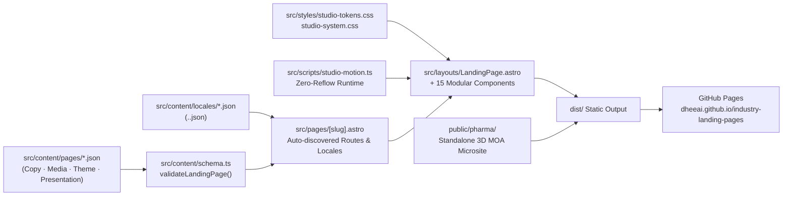

<div align="center">

# DHEE · Industry Landing Pages

**A config-driven, static-first Astro landing-page factory for complex technical products.**  
Built on a unified Vantablack Darkroom × Swiss Gallery design system with per-industry color tokens, interactive buyer studios, auto-discovered locales, and one-command scaffolding.

[](https://dheeai.github.io/industry-landing-pages/)
[](https://astro.build/)
[](#architecture)
[](#design-system--performance-guardrails)

</div>

---

## Live Verticals & Routes

Every route deploys statically to [`https://dheeai.github.io/industry-landing-pages/`](https://dheeai.github.io/industry-landing-pages/).

| Route | Vertical / Purpose | Page Type | Accent Theme | Notes |
| :--- | :--- | :---: | :--- | :--- |
| [`/`](https://dheeai.github.io/industry-landing-pages/) | **Portfolio Hub** | Hub | Studio Teal | Directory linking all live verticals & starter templates |
| [`/machinery/`](https://dheeai.github.io/industry-landing-pages/machinery/) | **EU Machinery Manufacturers** | `A` · Industry Trigger | Industrial Amber `#f59e0b` | 47s sample film, EU Reg 2023/1230 context, buyer Q&A |
| [`/robotics/`](https://dheeai.github.io/industry-landing-pages/robotics/) | **Robotics & Physical AI** | `D` · Demo Before Hardware | Precision Cyan `#38bdf8` | 30s concept film, bounded task flow, engineering boundaries |
| [`/pharma/`](https://dheeai.github.io/industry-landing-pages/pharma/) | **Pharma & Life Sciences** | Standalone Microsite | Bioluminescent Teal `#2dd4bf` | Interactive 3D MOA Canvas stage, storyboard studio, MLR review |
| [`/ml-7f4q9c2/`](https://dheeai.github.io/industry-landing-pages/ml-7f4q9c2/) | **Multiply Labs** (`noindex`) | `B` · Account Showcase | Bioluminescent Teal `#2dd4bf` | 25s product film, deliverables, 5 locales (`EN`/`DE`/`FR`/`IT`/`NL`) |
| [`/library-template/`](https://dheeai.github.io/industry-landing-pages/library-template/) | **Product Library Concept** (`noindex`) | `C` · Product Library | Studio Emerald `#10b981` | Reusable concept template for multi-product libraries |
| [`/partner-template/`](https://dheeai.github.io/industry-landing-pages/partner-template/) | **Channel Partner Concept** (`noindex`) | `E` · Channel Partner | Studio Violet `#a78bfa` | Reusable concept template for consultancies & integrators |

> **Page Types (`A`–`E`):** `A` Industry Trigger · `B` Account Pitch · `C` Product Library · `D` Demo-Before-Hardware · `E` Channel Partner.

---

## Architecture

One schema-validated config drives every route—zero duplicated page markup and zero hardcoded account branches.



---

## Quick Start

```sh
# 1. Install dependencies
npm ci

# 2. Run local dev server (http://127.0.0.1:4321)
npm run dev

# 3. Validate schemas and create production build in dist/
npm run build

# 4. Preview production build locally
npm run preview
```

---

## Add a New Industry Page in 1 Command

Use the built-in scaffolder to generate a schema-valid starter config complete with a matching per-type color palette:

```sh
npm run new-page -- medtech --type A --segment "Medical Device Teams"
```

| Flag | Default | Description |
| :--- | :--- | :--- |
| `<slug>` | *(required)* | Lowercase URL route slug (`a-z`, `0-9`, `-`), generates `src/content/pages/<slug>.json` |
| `--type` | `A` | Brief page type (`A`, `B`, `C`, `D`, or `E`) — also selects the default accent preset |
| `--segment` | Title-cased slug | Practice name shown in the header slate and starter SEO copy |

### Customizing a Page Config

Every page JSON supports optional declarative blocks without touching Astro code:

```json
{
  "slug": "medtech",
  "pageType": "A",
  "theme": {
    "accent": "#2dd4bf",
    "accentBright": "#5eead4",
    "accentDark": "#0f766e",
    "accentSecondary": "#3b82f6",
    "accentRgb": "45, 212, 191",
    "accentBrightRgb": "94, 234, 212",
    "ember": "#ff5a2f"
  },
  "presentation": {
    "layout": "standard",
    "heroMedia": "video",
    "practiceKicker": "MEDTECH FILMS",
    "practiceName": "MEDICAL DEVICES"
  },
  "marqueeItems": ["Mechanism clarity", "Reviewed claims", "Managed DHEE production"],
  "telemetry": [
    { "kicker": "SAMPLE RUNTIME", "value": "45", "unit": "sec", "countTo": 45, "body": "...", "dark": true }
  ]
}
```

### Adding Localized Editions

Drop a translation dictionary alongside any base slug in `src/content/locales/<slug>.<lang>.json` (for example `medtech.de.json`). `src/pages/[slug].astro` automatically generates the localized route, swaps captions if `captionsUrl` is set, and activates the header language switcher.

---

## Project Structure

```text
.
├── .github/workflows/
│   ├── deploy.yml                  # Two-job GitHub Pages build + deploy with route checks
│   └── validate-pr.yml             # PR check: JSON lint, Astro build, scaffolder smoke test
├── scripts/
│   └── new-page.mjs                # 1-command landing-page JSON scaffolder
├── public/
│   ├── images/                     # Brand marks & industry photography/illustrations
│   ├── videos/                     # Sample MP4s & WebVTT caption tracks
│   └── pharma/                     # Standalone Pharma & Life Sciences 3D MOA microsite
└── src/
    ├── components/                 # 15 reusable Astro sections (Hero, Header, Journey, etc.)
    ├── content/
    │   ├── schema.ts               # TypeScript schema, theme presets & strict validator
    │   ├── pages/*.json            # Vertical & account landing page configs
    │   └── locales/*.json          # Auto-discovered per-slug translations
    ├── layouts/
    │   └── LandingPage.astro       # Shared HTML shell, fonts, theme injection & analytics
    ├── pages/
    │   ├── index.astro             # Root Portfolio Hub (/)
    │   └── [slug].astro            # Composable dynamic route renderer
    ├── scripts/
    │   └── studio-motion.ts        # Adaptive header, tabs, scroll scrub, marquee & video
    └── styles/
        ├── studio-tokens.css       # Core typography, surfaces & overridable accent tokens
        └── studio-system.css       # Full Vantablack × Swiss Gallery component stylesheet
```

---

## Design System & Performance Guardrails

- **Visual Rhythm:** Alternating pure Vantablack (`#030508`) darkroom stages and Swiss Gallery (`#fbfbfa` / `#f2f3f5`) editorial bands, paired with `Newsreader` italic display typography, `Plus Jakarta Sans`, and `JetBrains Mono`.
- **Adaptive Chrome:** Floating glass command header automatically switches between dark and light contrast tones as sections scroll beneath it.
- **Zero-Reflow 60fps Motion:**
  - Cached marquee track widths (no `scrollWidth` reads inside `requestAnimationFrame`) with `IntersectionObserver` off-screen pausing.
  - Native cursor preserved (no blocking custom cursor rings), with pointer-reactive hero micro-grid, card spotlights, magnetic CTAs, and 3D micro-tilt.
  - Hover-only `conic-gradient` shimmer rims on primary buttons and full `prefers-reduced-motion` support.

---

## Campaign Analytics & Environment Variables

Copy `.env.example` to `.env` for local overrides. All variables are public build-time settings (never secrets):

| Variable | Purpose |
| :--- | :--- |
| `PUBLIC_PLAUSIBLE_DOMAIN` | Enables consent-gated Plausible tracking (requires `PUBLIC_PRIVACY_URL` too) |
| `PUBLIC_PRIVACY_URL` | Privacy notice link shown in footer and analytics consent banner |
| `PUBLIC_MULTIPLY_LABS_VIDEO_URL` | Optional CDN/streaming URL override for the Multiply Labs film (falls back to local MP4) |

When both Plausible settings are configured, tracking remains off until the visitor clicks **Accept analytics**, then records page views, scroll depth (`25/50/75/100%`), video playback milestones, CTA clicks, language switches, and UTM campaign parameters.

---

## Pre-Publish Review Checklist

- **Product & Technical Accuracy:** Replace illustrative concept visuals with approved product references (or CAD/measurement data where engineering fidelity is required) and have subject-matter experts sign off on scripts, claims, and captions.
- **Regulatory & Safety Boundaries:** Clearly label AI-assisted or concept animation as illustrative. Short product films support understanding—they never replace statutory instructions (e.g., EU Machinery Regulation 2023/1230), validated robotics simulations, safety cases, or MLR approval.
- **Translations:** Human-review any draft machine-translated locale files (`DE`, `FR`, `IT`, `NL`) and caption tracks before external outreach.
- **Standalone Pharma Microsite:** `public/pharma/` ships independently into `dist/pharma/` during `npm run build` so scientific/MLR review cycles stay isolated from the Astro verticals.

---

## CI/CD & Deployment

- **Production Deploy (`.github/workflows/deploy.yml`):** Triggers on pushes to `main` and manual dispatch, running `build` and `deploy` as separate jobs with route verification (`index.html`, `machinery/`, `robotics/`, `pharma/`, `ml-7f4q9c2/`) and `.nojekyll` generation.
- **Pull Request Validation (`.github/workflows/validate-pr.yml`):** Validates JSON syntax, runs `npm run build` schema checks, verifies critical routes, and smoke-tests `npm run new-page` on every PR targeting `main`.
- **Site Configuration:** Update `site` and `base` in `astro.config.mjs` if migrating to a custom domain.
